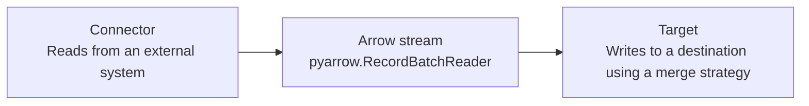

# arrow-ingest

[](https://github.com/maas-vansteenbergen/arrow-ingest/actions/workflows/ci.yml)

Use `arrow-ingest` to move data from a supported source to a supported target
through an Arrow stream. It keeps ingestion configuration explicit without
adding a pipeline runtime or hidden metadata columns.

You can:

- Read REST JSON APIs and local Parquet files.
- Write local Parquet files and DuckDB tables.
- Replace, append, upsert, or retain SCD2 history.

## Use one Arrow data boundary

Connectors produce `pyarrow.RecordBatchReader` streams. Targets consume those
streams and apply an explicit merge strategy. This is the only data contract
between sources and targets.

New integrations use this boundary instead of creating a separate data path or
intermediate data model. Arrow carries an explicit schema with the batches, so
the library can validate types while streaming data without loading the entire
source into memory.

## Architecture



## Install

Install Python 3.12 or later, then synchronize the development dependencies:

```console
uv sync --dev
```

## Run the sample pipeline

Run the included configuration:

```console
uv run python demo.py pipeline.yaml
```

[pipeline.yaml](./pipeline.yaml) reads a paginated product API and writes a
Parquet file.

## Configure a pipeline

Each pipeline file has a source connector, a merge strategy, and a target:

```yaml
connector:
  type: rest
  url: https://api.example.com/products
  records_path: products
  schema:
    id: int64
    title: string
merge: replace
target:
  type: parquet
  path: ./output/products.parquet
```

For a complete runnable REST-to-Parquet example, see
[pipeline.yaml](./pipeline.yaml).

Use the REST connector for JSON APIs and the Parquet connector for local
Parquet files. Use the Parquet target for one output file or the DuckDB target
for one table.

Choose a merge strategy that matches the load:

- Use `replace` for a first or full refresh.
- Use `append` to retain existing rows.
- Use `upsert` to replace rows with matching keys.
- Use `scd2` to retain a history of changes.

You can add bearer authentication, offset pagination, request retries, and a
destination-derived high-watermark cursor to a REST connector. See the
[YAML configuration reference](./docs/configuration-reference.md) for all
supported fields, defaults, validation rules, and complete examples.

## Use the Python API

Use the Python API when YAML does not fit your integration. The public package
provides `Connector` and `Target` protocols, `Cursor`, `MergeConfiguration`,
and `SCD2Configuration` data classes, merge parsing helpers, and the built-in
connector and target implementations. Connectors return Arrow stream readers.
Targets consume readers and return the number of incoming rows written.

## Develop and validate changes

Install [just](https://just.systems/) to run local development commands:

```console
just --list
just check
```

Run `just check` before you open a pull request. It synchronizes locked
dependencies, then runs tests, linting, and formatting checks. Run
`just release-check` to also build the source distribution and wheel.

Generate a branch-coverage report:

```console
just coverage
```

The command writes an HTML report to `htmlcov/index.html` and an XML report to
`coverage.xml`. CI uploads both files as the `coverage-report` artifact.

## Review release information

The project is in the `0.x` alpha series. Read [CHANGELOG.md](./CHANGELOG.md)
for release notes and [RELEASING.md](./RELEASING.md) for the versioning and
release process.

## Contributing

Read [CONTRIBUTING.md](./CONTRIBUTING.md) for the development workflow,
required checks, design guidelines, and documentation standards.
