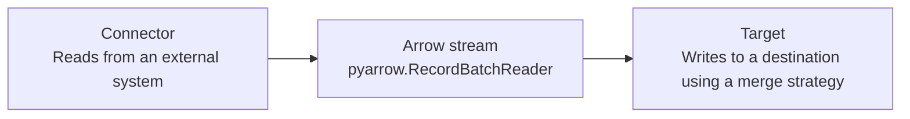

# arrow-ingest

[](https://github.com/maas-vansteenbergen/arrow-ingest/actions/workflows/ci.yml)

`arrow-ingest` is a small, Arrow-native ingestion library. Connectors produce
`pyarrow.RecordBatchReader` streams, and targets consume those streams without
introducing a pipeline runtime or hidden metadata columns.

The project currently supports:

- REST JSON and local Parquet connectors;
- local Parquet files and DuckDB tables as targets; and
- replace, append, upsert, and SCD2 merge strategies.

## Why this exists

Ingestion libraries do not need a large abstraction surface or separate data
paths for every kind of source and destination. A connector can read from an
external system, produce an Arrow stream, and a target can load that stream
with an explicit merge strategy.

`arrow-ingest` keeps that boundary deliberately small: connectors emit
`pyarrow.RecordBatchReader` streams and targets consume them. New integrations
adapt to those same contracts instead of introducing a new pipeline runtime,
intermediate data model, or special-case execution path.

Arrow is especially suitable for this boundary. Its columnar format carries an
explicit schema alongside batches of data, which makes type handling
predictable while allowing records to be streamed without materializing an
entire dataset. It is also widely supported across data tools, so connectors
and targets can interoperate with fewer conversions and copies.

## Architecture



The Arrow stream is the only data contract between connectors and targets.

## Install

The project requires Python 3.12 or later.

```console
uv sync --dev
```

## Run an ingestion

Configure the connector, merge strategy, and target in YAML, then run the
included command-line entry point:

```console
uv run python demo.py pipeline.yaml
```

The repository's [`pipeline.yaml`](./pipeline.yaml) is a runnable example
that reads paginated product data and writes a Parquet file.

## Configuration

### REST connector

```yaml
connector:
  type: rest
  url: https://api.example.com/products
  records_path: data.products
  schema:
    id: int64
    title: string
    price: float64
  schema_policy: strict
  params:
    locale: en
  headers:
    Accept: application/json
  cursor:
    type: high_watermark
    field: id
    request_param: after_id
  pagination:
    type: offset
    offset_param: offset
    limit_param: limit
    page_size: 100
    total_path: meta.total
  request:
    timeout_seconds: 30
    retries: 3
    backoff_seconds: 1
```

`records_path` and `total_path` support dot-separated paths into JSON objects.
The strict schema policy requires every declared field in each record to have
the configured primitive Arrow type. Extra fields are ignored. Supported
schema values are `int64`, `float64`, `string`, and `bool`.

REST requests can use bearer authentication without storing the secret in
YAML:

```yaml
auth:
  type: bearer
  token_env: PRODUCTS_API_TOKEN
```

Set the named environment variable before running the command. When bearer
authentication is configured, do not also configure an `Authorization` header.

### Parquet connector

```yaml
connector:
  type: parquet
  path: ./input/products.parquet
```

Parquet connectors stream local files and do not support cursors.

### Targets

```yaml
target:
  type: parquet
  path: ./output/products.parquet
```

```yaml
target:
  type: duckdb
  path: ./output/warehouse.duckdb
  table: products
```

Both targets can derive a high-watermark from an existing integer destination
field for incremental REST loads.

### Merge strategies

Use `replace` to overwrite the destination or `append` to add incoming rows:

```yaml
merge: replace
```

Use `upsert` to replace destination rows that share the configured key tuple.
Incoming key values must be non-null and unique, and the input schema must
match the existing destination schema.

```yaml
merge:
  strategy: upsert
  keys: [id]
```

Use SCD2 to preserve row history. A new version is created only when a tracked
field changes, and every incoming version must be later than the current one
for its key.

```yaml
merge:
  strategy: scd2
  keys: [id]
  tracked_fields: [title, price]
  effective_at: version
  valid_from: valid_from
  valid_to: valid_to
  is_current: is_current
```

## Library API

The public package exports `Connector` and `Target` protocols, the
`Cursor`, `MergeConfiguration`, and `SCD2Configuration` data classes, merge
strategy parsing helpers, and the built-in connector and target
implementations. Connectors return Arrow stream readers; targets accept them
and return the number of incoming rows written.

## Development

Run the tests and lint checks with:

```console
uv run pytest
uv run ruff check .
```

Generate a branch-coverage report with missing lines:

```console
uv run pytest --cov --cov-report=term-missing --cov-report=html --cov-report=xml
```

The HTML report is written to `htmlcov/index.html` and the XML report to
`coverage.xml`. CI uploads both as the `coverage-report` workflow artifact.

## Contributing

See [CONTRIBUTING.md](./CONTRIBUTING.md) for the development workflow, required
checks, and design guidelines.
